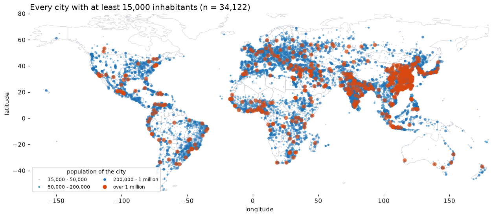
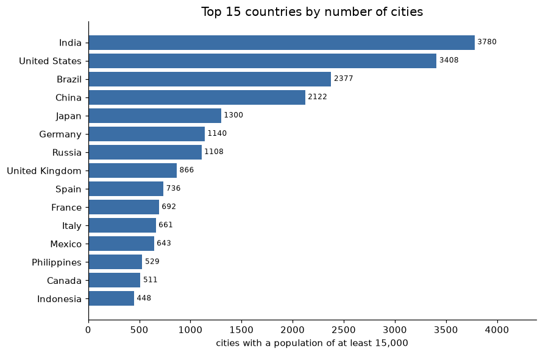

# Yifei He

**Data science student at the University of Macau · Python · data visualisation**

---

## About me

I am a master's student in the Data Science programme at the University of Macau. Most of my
work starts the same way: take a messy public dataset, clean it with pandas, and then keep
redrawing the chart until the pattern in the data is actually visible. I am particularly
interested in geospatial visualisation - maps that show *where* something happens rather
than only *how much* of it there is.

This site is my data science portfolio. It is built with GitHub Pages from
[this repository](https://github.com/dreambyrain/data-science-portfolio).

## Technical skills

| Area | Tools I use |
| --- | --- |
| Data handling | Python, pandas, NumPy |
| Visualisation | matplotlib, seaborn, geoplotlib |
| Statistics / analysis | exploratory data analysis, groupby aggregation, distribution analysis |
| Workflow | Jupyter Notebook, Git and GitHub, Markdown |

## Project showcase

### Where are the world's larger cities?

**Research question.** If you only keep towns and cities with at least 15,000 inhabitants,
where are they concentrated, and which countries hold the most of them?

**What the visualisation shows.** The 34,122 cities in the GeoNames `cities15000` dataset are
not spread evenly across the world at all. Four corridors hold most of them - western and
central Europe, the Indian subcontinent, eastern China, and the eastern half of the United
States - while Siberia, the Sahara, the Amazon basin and central Australia are almost empty.
The orange dots, the cities above one million inhabitants, sit almost entirely inside those
same corridors.

The second figure counts the cities per country: India (3,780), the United States (3,408) and
Brazil (2,377) come first, ahead of China (2,122).

* **Repository:** [github.com/dreambyrain/data-science-project](https://github.com/dreambyrain/data-science-project)
* **Status:** completed
* **Dataset and licence:** GeoNames `cities15000` (CC BY 4.0) and Natural Earth country
  boundaries (public domain). Both are downloaded by the notebook, so no data is redistributed
  on this site.
* **Main limitation:** GeoNames is volunteered data rather than a census, and the place list is
  only complete where contributors have been active. Brazil ranking above China is the clearest
  symptom, so the country counts measure how many places are *mapped*, not how many towns a
  country really has.

## What I want to improve next

Two things. First, the country comparison should be normalised - cities per million
inhabitants, or the share of the national population living in cities above 15,000 - because
raw counts mix urbanisation with data coverage. Second, I want to move from static PNG figures
to an interactive map (folium or Bokeh) so that a reader can zoom into a corridor and inspect
the individual cities.

---

*Built with Markdown and GitHub Pages.*
